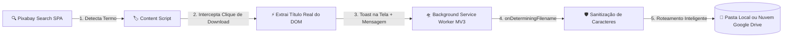

<div align="center">


# ⚡ PIXABAY SMART ORGANIZER
### *A Extensão Quântica para Downloads Inteligentes de Áudios, Músicas e Trilhas*

[](https://developer.chrome.com/docs/extensions/mv3/)
[](https://pixabay.com)
[](https://deepmind.google)
[](LICENSE)
[]()

<p align="center">
  <b>Diga adeus à selva caótica da sua pasta de Downloads.</b><br>
  Toda vez que você pesquisa por <i>"comercial"</i>, <i>"marcha"</i>, <i>"vinheta"</i> ou <i>"podcast"</i> no Pixabay,<br>
  seus arquivos são instantaneamente capturados, limpos e salvos na pasta exata do projeto — ou sincronizados direto no seu <b>Google Drive</b>.
</p>

---

[🚀 Instalação Rápida](#-instalação-rápida-no-chrome) •
[✨ Recursos](#-super-recursos) •
[☁️ Sincronização Google Drive](#️-a-mágica-do-google-drive-na-nuvem) •
[🤝 Patrocinador & Colaboradores](#-patrocinador-oficial--co-laboratórios) •
[📚 Referências](#-referências-de-código-aberto) •
[📦 Deploy no GitHub](#-como-subir-este-projeto-no-github)

---

</div>

## 🌌 O Problema Real & A Solução Elegante

Quem produz conteúdo ou trabalha com audiovisual sabe da dor: você passa horas procurando a trilha perfeita no Pixabay, clica em baixar, e o arquivo vem batizado como:
```text
corporate-music-1489201_original.mp3
```
Ele cai no limbo da pasta `Downloads` junto com notas fiscais, boletos e memes. Dois dias depois, você apaga a pasta por engano e precisa recomeçar do zero porque ninguém sabe o que diabos é `corporate-music-1489201`.

### 🎯 Com o Pixabay Smart Organizer:
1. Você pesquisa `comercial` no Pixabay.
2. Clica no botão de download da faixa *"Upbeat Energy"*.
3. O script intercepta o evento, extrai o título real do player da tela e salva:
```text
📁 Google Drive (ou Downloads)
└── 📁 Comercial/
    └── 🎵 Comercial - Upbeat Energy.mp3
```
Um **Toast flutuante** futurista pisca no canto da tela confirmando a operação com zero fricção.

---

## 🏗️ Arquitetura do Fluxo



---

## ✨ Super Recursos

- **🧠 Detecção Semântica em Tempo Real:** Lê a URL do SPA (`/music/search/...`, `/sound-effects/...`, tags de gênero ou campos de busca).
- **🎵 DOM Player Scraper:** Não salva hashes numéricos feios; lê o nome real da faixa do player do Pixabay antes do download disparar.
- **☁️ Integração com Google Drive (Mac & PC):** Roteia arquivos direto para a nuvem da empresa através do atalho de sistema nativo.
- **🎛️ Painel Popup Moderno:**
  - Alternador de ativação (Toggle On/Off).
  - Seletor rápido de pastas (`☁️ Google Drive`, `🎵 Pixabay`, `💼 Comerciais`, `🔊 Efeitos`).
  - Chips de categorias com 1 clique.
  - Formato de nomenclatura personalizável (`[Categoria] - [Título]` ou com `[Data]`).
  - Histórico colapsável discreto para checagem rápida.
- **🛡️ Escudo de Sanitização:** Higieniza caracteres ilegais (`< > : " / \ | ? *`) para garantir integridade no macOS, Windows e Linux.

---

## ☁️ A Mágica do Google Drive na Nuvem

Como as extensões do Chrome só podem escrever dentro da sandbox de downloads, criamos uma **ponte transparente no macOS**:
Um atalho do sistema (`symlink`) que conecta `~/Downloads/GoogleDrive-Pixabay` diretamente à sua pasta compartilhada do Google Drive:

```bash
ln -snf "/Users/SEU_USUARIO/Library/CloudStorage/GoogleDrive-SUA_CONTA/Discos partilhados/PASTA_DO_DRIVE" ~/Downloads/GoogleDrive-Pixabay
```
Quando o Chrome envia o arquivo para a pasta `GoogleDrive-Pixabay`, o sistema operacional desvia o fluxo silenciosamente para dentro do seu **Google Drive corporativo**, sincronizando na nuvem com toda a sua equipe na velocidade da luz!

---

## 🚀 Instalação Rápida no Chrome

Não precisa compilar, instalar Node ou rodar `npm build`. É Vanilla JS puro e ultrarrápido:

1. **Clone ou baixe** este repositório para o seu computador.
2. Abra o Google Chrome e vá para a tela de extensões:
   ```text
   chrome://extensions/
   ```
3. No canto superior direito, ative o switch **"Modo do desenvolvedor"** (*Developer mode*).
4. No canto superior esquerdo, clique em **"Carregar sem compactação"** (*Load unpacked*).
5. Selecione a pasta `pixabay-smart-organizer`.
6. Fixe o ícone verde na sua barra de extensões do Chrome.
7. Abra o [Pixabay](https://pixabay.com), faça uma busca por áudios e aproveite!

---

## 🌟 Patrocinador Oficial & Co-Laboratórios

<table align="center" width="100%">
  <tr>
    <td align="center" width="50%">
      <h3>👑 PATROCINADOR OFICIAL DE MÍDIA</h3>
      <a href="https://pixabay.com" target="_blank">
        <br>
        <b>Pixabay.com</b>
      </a>
      <p><i>A maior comunidade criativa de mídia e trilhas sonoras livres de direitos autorais do planeta. Provedora oficial das faixas organizadas por esta extensão.</i></p>
    </td>
    <td align="center" width="50%">
      <h3>🛸 IA & ENGENHARIA DE SISTEMAS</h3>
      <a href="https://deepmind.google" target="_blank">
        <br>
        <b>Google Antigravity &amp; Google DeepMind</b>
      </a>
      <p><i>Arquitetura agentic, orquestração de código autônomo e design de sistemas Manifest V3 idealizados em cooperação simbiótica com inteligência artificial avançada.</i></p>
    </td>
  </tr>
</table>

---

## 📚 Referências de Código Aberto

Este projeto foi construído sobre os ombros de gigantes da comunidade open-source e documentações oficiais da Web:

* 📦 **[FButros / DownloadsOrganiser](https://github.com/FButros/DownloadsOrganiser):** Padrão de mapeamento e categorização de downloads no ecossistema Chromium.
* 📦 **[unintended / download-organizer-chrome-extension](https://github.com/unintended/download-organizer-chrome-extension):** Filosofia de regex dinâmico para subpastas de downloads.
* 📦 **[aidandj / Chrome-Download-Organizer](https://github.com/aidandj/Chrome-Download-Organizer):** Estrutura leve de listeners de eventos no navegador.
* 📦 **[rpawk / image_downloader](https://github.com/rpawk/image_downloader):** Técnicas de extração direta de elementos de mídia em plataformas de stock.
* 📖 **[Google Chrome Extensions API Documentation](https://developer.chrome.com/docs/extensions/reference/api/downloads):** Especificação oficial da API `chrome.downloads.onDeterminingFilename`.

---

## 📦 Como Subir este Projeto no GitHub

Para publicar agora mesmo e compartilhar com o mundo:

```bash
# 1. Entre na pasta da extensão
cd "pixabay-smart-organizer"

# 2. Inicialize o repositório git
git init

# 3. Adicione todos os arquivos
git add .

# 4. Faça o primeiro commit
git commit -m "feat: initial launch of Pixabay Smart Organizer with Google Drive sync"

# 5. Defina a branch principal como main
git branch -M main

# 6. Conecte ao seu repositório no GitHub (crie antes um repositório vazio no github.com):
git remote add origin https://github.com/SEU-USUARIO/pixabay-smart-organizer.git

# 7. Suba o código para as estrelas!
git push -u origin main
```

---

## 📄 Licença

Este projeto é de código aberto sob a licença **MIT** — sinta-se livre para usar, modificar, distribuir e evoluir. Veja o arquivo [LICENSE](LICENSE) para mais detalhes.

<div align="center">
  <sub>Criado com paixão criativa, café e inteligência artificial • 2026</sub>
</div>
