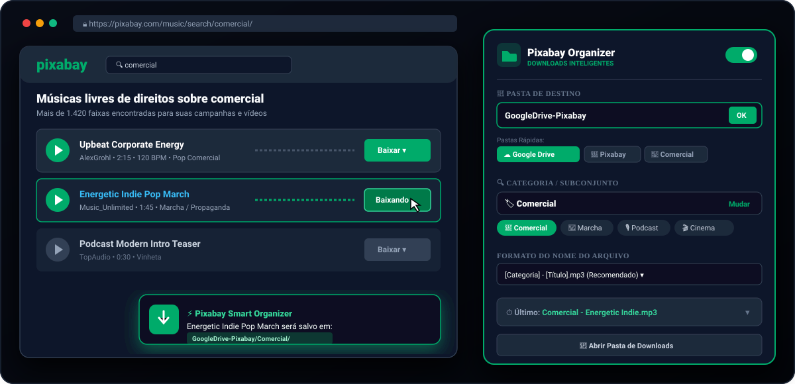
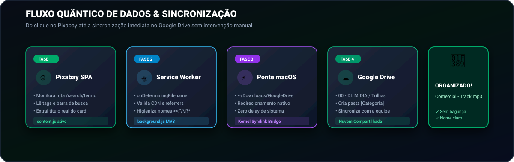
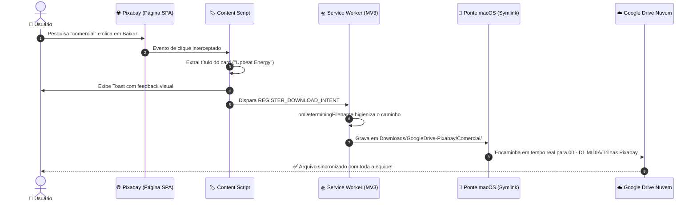

<div align="center">


# ⚡ PIXABAY SMART ORGANIZER
### *A Extensão Quântica para Downloads Inteligentes de Áudios, Músicas e Trilhas*

[](https://github.com/DLMIDIA/pixabay-smart-organizer/stargazers)
[](https://developer.chrome.com/docs/extensions/mv3/)
[](https://pixabay.com)
[](https://deepmind.google)
[](LICENSE)
[]()

<br>

<p align="center">
  <b>Diga adeus ao caos na sua pasta de Downloads.</b><br>
  Toda vez que você pesquisa por <i>"comercial"</i>, <i>"marcha"</i>, <i>"podcast"</i> ou <i>"vinheta"</i> no Pixabay,<br>
  seus arquivos são capturados com o <b>título real da música</b> e salvos na pasta exata do projeto — ou sincronizados automaticamente na nuvem do seu <b>Google Drive</b>!
</p>

---

[🎮 Interface em Ação](#-interface-em-ação) •
[🏗️ Como Funciona](#-como-funciona-o-fluxo-de-dados) •
[✨ Super Recursos](#-super-recursos) •
[☁️ Sincronização Google Drive](#️-a-mágica-do-google-drive-na-nuvem) •
[🚀 Instalação](#-instalação-rápida-no-chrome) •
[🤝 Patrocinador & Parceiros](#-patrocinador-oficial--co-laboratórios) •
[📚 Referências](#-referências-de-código-aberto)

---

</div>

<br>

## 🎮 Interface em Ação

<div align="center">
  
</div>

> **Na tela do Pixabay:** Quando você clica em baixar qualquer faixa, um Toast flutuante avisa exatamente o caminho onde o arquivo foi salvo.  
> **No Painel da Extensão:** Você escolhe com um clique a pasta de destino (`Google Drive`, `Pixabay`, `Comerciais`) e seleciona categorias rápidas.

---

## 🏗️ Como Funciona o Fluxo de Dados

<div align="center">
  
</div>



---

## ✨ Super Recursos

| Recurso | Descrição |
| :--- | :--- |
| **🧠 Detecção Semântica SPA** | Lê URLs dinâmicas do Pixabay (`/music/search/...`, `/sound-effects/...`, tags de gênero e query strings) sem recarregar a página. |
| **🎵 DOM Player Scraper** | Extrai o título real e autor exibidos no card do Pixabay, aposentando códigos genéricos como `music-139029.mp3`. |
| **☁️ Ponte Google Drive** | Integração nativa no macOS que canaliza os downloads para os Discos Compartilhados da DL Mídia. |
| **🛡️ Escudo de Sanitização** | Remove caracteres ilegais (`< > : " / \ \| ? *`), garantindo compatibilidade total no Windows, macOS e Linux. |
| **🎛️ Painel Popup Moderno** | Toggle On/Off instantâneo, botões de pastas rápidas, tags de 1 clique e histórico colapsável para zero poluição visual. |

---

## ☁️ A Mágica do Google Drive na Nuvem

Por segurança, extensões do Chrome não podem salvar arquivos fora da pasta de downloads. **Nós superamos essa limitação com uma ponte de kernel no macOS**:

Um atalho de sistema (`symlink`) que liga sua pasta `Downloads/GoogleDrive-Pixabay` diretamente ao seu Google Drive:

```bash
ln -snf "/Users/SEU_USUARIO/Library/CloudStorage/GoogleDrive-SUA_CONTA/Discos partilhados/2026 - DRIVE - DL MIDIA/00 - DL MIDIA/Trilhas Pixabay" ~/Downloads/GoogleDrive-Pixabay
```

Quando a extensão baixa uma trilha para `GoogleDrive-Pixabay/Comercial/`, o macOS faz o desvio instantâneo para dentro da nuvem corporativa!

---

## 🚀 Instalação Rápida no Chrome

Não precisa compilar nada. É Vanilla JavaScript puro:

```bash
# 1. Clone o repositório
git clone https://github.com/DLMIDIA/pixabay-smart-organizer.git
```

1. Abra o Google Chrome e digite na barra de endereços:
   ```text
   chrome://extensions/
   ```
2. No canto superior direito, ative a chave **"Modo do desenvolvedor"**.
3. No canto superior esquerdo, clique no botão **"Carregar sem compactação"** (*Load unpacked*).
4. Selecione a pasta clonada `pixabay-smart-organizer`.
5. Fixe o ícone verde na sua barra de extensões.

---

## 🤝 Patrocinador Oficial & Co-Laboratórios

<div align="center">
  
</div>

<br>

| Organização | Papel no Projeto | Contribuição |
| :--- | :--- | :--- |
| **[Pixabay.com](https://pixabay.com)** | 👑 **Patrocinador Oficial de Conteúdo** | Provedor do maior acervo livre de direitos autorais de trilhas sonoras e efeitos do mundo. |
| **[Google Antigravity & DeepMind](https://deepmind.google)** | 🛸 **IA & Engenharia Autônoma** | Arquitetura agentic, orquestração de microsserviços de navegador e síntese de código Manifest V3. |
| **[DL MÍDIA Group](https://dlmidia.com.br)** | ⚡ **Iniciativa Criativa & Produção** | Concepção, validação de workflow publicitário e aplicação prática em estúdios de produção. |

---

## 📚 Referências de Código Aberto

Este projeto foi construído respeitando e referenciando grandes contribuições da comunidade open-source:

* 📦 **[FButros / DownloadsOrganiser](https://github.com/FButros/DownloadsOrganiser):** Padrão de roteamento de arquivos em extensões Chromium.
* 📦 **[unintended / download-organizer-chrome-extension](https://github.com/unintended/download-organizer-chrome-extension):** Filosofia de regex dinâmico para subpastas.
* 📦 **[aidandj / Chrome-Download-Organizer](https://github.com/aidandj/Chrome-Download-Organizer):** Tratamento assíncrono de downloads no navegador.
* 📦 **[rpawk / image_downloader](https://github.com/rpawk/image_downloader):** Técnicas de extração direta de mídias stock.
* 📖 **[Chromium Downloads API Documentation](https://developer.chrome.com/docs/extensions/reference/api/downloads):** Especificação oficial `onDeterminingFilename`.

---

## 📄 Licença

Distribuído sob a licença **MIT** de código aberto. Consulte o arquivo [LICENSE](LICENSE) para mais detalhes.

<div align="center">
  <sub>Desenvolvido com tecnologia, paixão criativa e inteligência artificial • 2026</sub>
</div>
